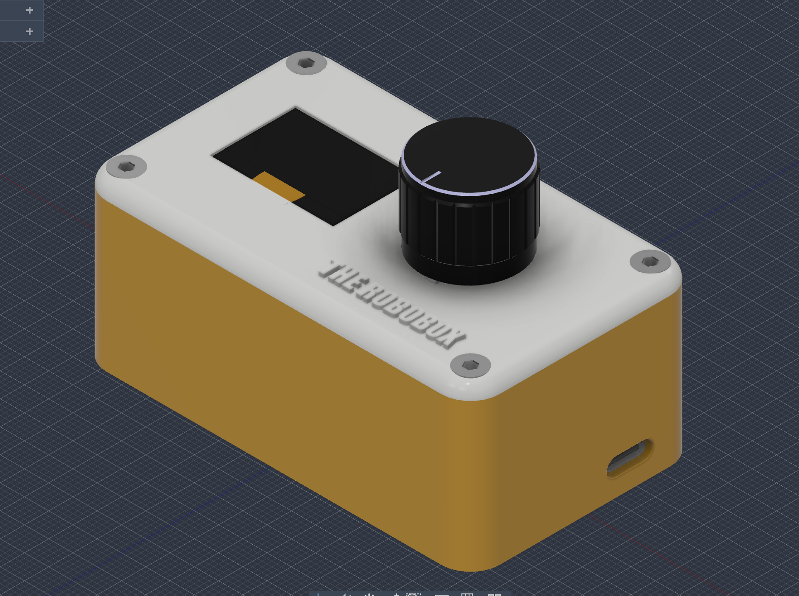
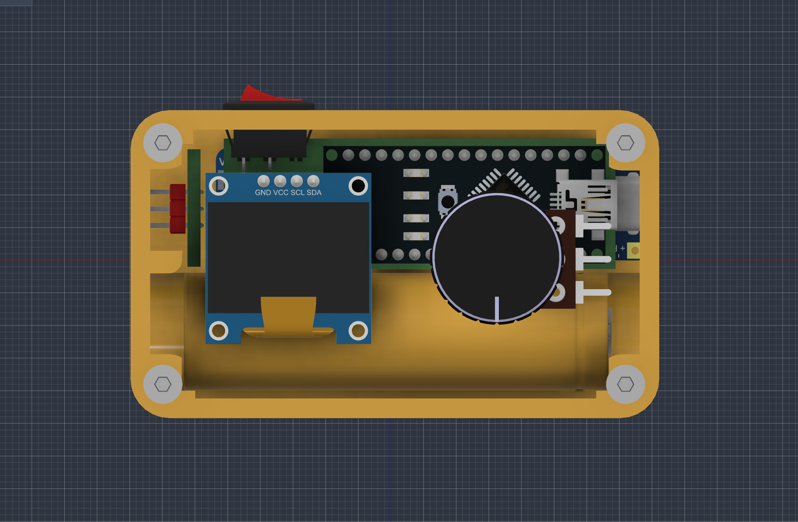
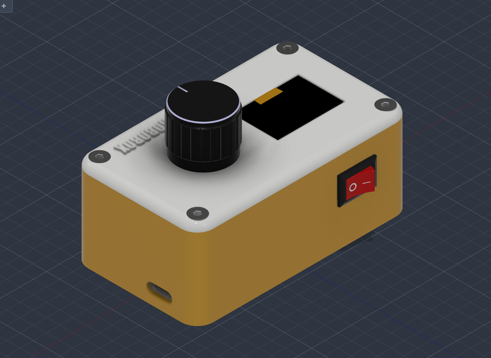

#  The Single-Pot Servo Controller & Macro Pad

A compact, 3D-printable, rechargeable control console designed for makers, robotics enthusiasts, and DIY builders. Take precise control of your servos, testbenches, or custom computer macros with clean hardware and reliable portability.

---

## 📸 Project Previews

| Assembled Console | Electronics Layout | CAD Assembly |
| :---: | :---: | :---: |
|  |  |  |

---

## 🚀 Features

- 🎛️ **Precision Input:** Smooth rotary potentiometer for real-time manual servo positioning or analog macro control.
- 📺 **Visual Feedback:** Precision cutout designed for a **0.96" I2C OLED display (128x64)** to monitor live angles, PWM signal values, or custom UI menus.
- 🔋 **Portable Power Management:** Houses a single **18650 Li-ion battery** paired with a **TP4056 USB-C charging module** for untethered, rechargeable operation.
- ⚙️ **Robust Enclosure:** Uses **M3 heat-set brass inserts** and socket head cap screws for reliable, repeated mechanical assembly and disassembly.
- 📐 **Customizable CAD Source:** Complete parametric **Autodesk Fusion 360 source file** included to tweak component tolerances or add extra controls.

---

## 🌐 Technologies & Components Used

- **Microcontroller**: Arduino Nano / Pro Micro (30-pin narrow format)
- **Display**: 0.96" I2C OLED Display Module (128x64)
- **Input Device**: 10k Ohm Rotary Potentiometer & KCD1 Miniature Rocker Switch
- **Power & Charging**: 18650 Li-ion Battery & TP4056 USB-C Module
- **Mechanical Hardware**: M3 x 10mm Hex Socket Cap Screws & M3 Brass Heat-Set Inserts
- **Fabrication**: 3D Printed Enclosure (Base Body, Top Lid, and Custom Knurled Knob)
- **Firmware**: Arduino C++

---

## 🛠️ Individual Component Wiring

### 📺 0.96" I2C OLED Display
| Pin | Microcontroller Pin | Description |
| :--- | :--- | :--- |
| VCC | 3.3V / 5V | Power |
| GND | GND | Ground |
| SDA | A4 (Nano) / Pin 2 (Pro Micro) | I2C Data |
| SCL | A5 (Nano) / Pin 3 (Pro Micro) | I2C Clock |

---

### 🎛️ Rotary Potentiometer
| Pin | Microcontroller Pin | Description |
| :--- | :--- | :--- |
| Pin 1 (Outer) | GND | Ground Reference |
| Pin 2 (Wiper) | Analog Pin `A0` | Analog Input Signal |
| Pin 3 (Outer) | 5V | Reference Voltage |

---

### ⚡ Power & Charging Circuit
| Component Pin | Connection Target | Description |
| :--- | :--- | :--- |
| 18650 Battery `+` / `-` | TP4056 `B+` / `B-` | Direct battery leads |
| TP4056 `OUT+` | Rocker Switch (IN) | Switched power line |
| Rocker Switch (OUT) | Nano/Pro Micro `5V` or `RAW` | System power rail |
| TP4056 `OUT-` | System Common `GND` | Ground rail |

---

## 🖨️ Assembly & Print Tips

- **Print Settings:** Recommended **PLA, PETG, or ABS** with at least **3 perimeters/walls** to ensure strong structural rigidity around screw mounting posts.
- **Infill:** **15% – 20%** (Gyroid infill recommended for optimal strength-to-weight ratio and print speed).
- **Supports:** Minimal supports required—enable them **only** for the side rocker switch cutout and the USB-C charging port slot.
- **Heat-Set Inserts:** Use a soldering iron set to **~220°C** to press the M3 brass inserts cleanly into the top mounting posts of the lower base body.
- **Aesthetics:** A two-tone print (contrasting base and lid colors) gives the finished console a sleek, modern look.

---

## 📁 Repository Folder Structure

```text
servo-controller-macro-pad/
├── 📁 cad/
│   └── ServoController_Assembly.f3d
├── 📁 stl/
│   ├── ServoController_Base.stl
│   ├── ServoController_TopLid.stl
│   └── ServoController_Knob.stl
├── 📁 firmware/
│   └── ServoController.ino
├── image1.png
├── image2.png
├── image3.png
└── README.md
```

---

## 👤 Author

**Rupesh H. Thakur**  
🎓 BSc.IT Student, Thakur College of Science and Commerce  
🔗 [GitHub – @Rupesh6786](https://github.com/Rupesh6786)  
📧 Email: 55rupeshthakur@gmail.com  

---

## 📄 License

This project is licensed under the **MIT License**.  
See the [LICENSE](LICENSE) file for more information.

---
